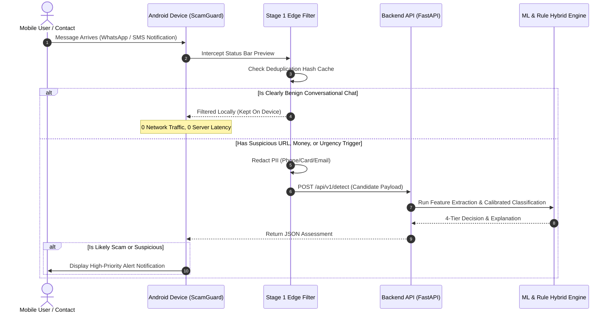

# System Architecture & Technical Specifications
**ScamGuard AI — Selective Mobile Scam Detection System**

---

## 1. High-Level Architecture Diagram

```mermaid
graph TD
    subgraph Client_Layer["Client Layer"]
        A1["Android Native App<br/>(NotificationListenerService & ShareSheet)"]
        A2["Responsive Web App<br/>(HTML5 / Tailwind CSS / Vanilla JS)"]
    end

    subgraph Stage_1["Stage 1: Edge / On-Device Prefilter"]
        B1["Hash Deduplication Cache"]
        B2["Lightweight Regex Pre-Filter<br/>(URLs, Financials, Urgency, Call-to-Action)"]
        B3["On-Device PII Redactor<br/>(Phone / Card / Email Masking)"]
    end

    subgraph Stage_2["Stage 2: Remote Detection Engine (FastAPI)"]
        C1["Token-Bucket Rate Limiter & Validation"]
        C2["Heuristic Rule Engine<br/>(Urgency, OTPs, Banking, Obfuscation)"]
        C3["Calibrated ML Classifier<br/>(TF-IDF + Calibrated Logistic Regression)"]
        C4["Hybrid Fusion Matrix<br/>(4-Tier Decision Engine)"]
    end

    subgraph Persistence_Layer["Privacy-Preserving Audit Store"]
        D1[("SQLite with WAL Mode<br/>Zero Raw Retention<br/>SHA-256 Session Isolated")]
    end

    A1 -->|Incoming Notification| B1
    B1 --> B2
    B2 -->|Clearly Benign (89.96%)| Safe_Local["Kept On Device (0.5ms)<br/>No Server Call"]
    B2 -->|Candidate Event| B3
    B3 -->|HTTPS JSON Payload| C1
    A1 -->|User Manual Paste / Share| C1
    A2 -->|Web User Submission| C1

    C1 --> C2
    C1 --> C3
    C2 --> C4
    C3 --> C4
    C4 --> D1
    C4 -->|Structured 4-Tier Assessment| Output["Likely Safe | Suspicious | Likely Scam | Unable to Determine"]
```

---

## 2. Event-Driven Workflow Sequence



---

## 3. The 4-Tier Decision Taxonomy

Instead of a misleading binary threshold, ScamGuard implements an interpretable 4-tier decision taxonomy:

| Tier | Score Range | Criteria & Triggers | Recommended User Action |
| :--- | :---: | :--- | :--- |
| **Likely Safe** | 0.0 – 31.9 | No threat indicators; high statistical lexical similarity to normal communication. | Normal caution; remember familiar contacts can occasionally be compromised. |
| **Suspicious** | 32.0 – 64.9 | Moderate risk signals (unsolicited marketing, shortened links, vague financial claims) or conflicting signals between rules and ML. | Exercise vigilance; do not disclose sensitive info or click unfamiliar domains. |
| **Likely Scam** | 65.0 – 100.0 | High ML probability combined with critical indicators (OTP/password harvest, bank impersonation, lottery lure, account threat). | **DO NOT click links, NEVER share OTPs**, block sender, verify independently. |
| **Unable to Determine** | Variable | Very brief message (1–3 words, e.g., *"Ok call me"*) lacking sufficient context or indicators. | Request clarification from sender through a trusted secondary channel. |

---

## 4. Supported Android Integrations & Real-World Limitations

1. **WhatsApp Notifications:**
   - *Supported:* Extracts title (sender/group) and notification text preview (`android.text`).
   - *Limitation:* WhatsApp truncates long messages in the status bar preview.
   - *Mitigation:* Users can use the native Android Share Sheet (`ACTION_SEND`) to share the full message directly to ScamGuard.
2. **SMS / Google Messages:**
   - *Supported:* Intercepts incoming SMS notifications without needing default SMS app privileges.
   - *Limitation:* Does not access past SMS inbox history.
3. **Gmail Notifications:**
   - *Supported:* Reads subject line and brief preview snippet from status bar.
   - *Limitation:* Email body and attachments are not accessible via notifications.
